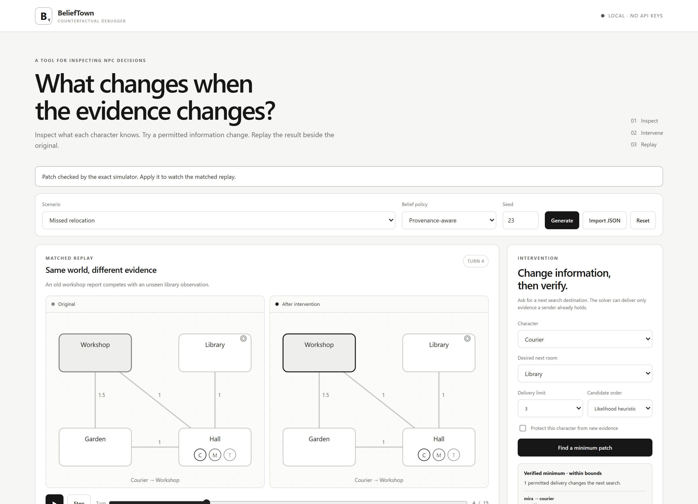
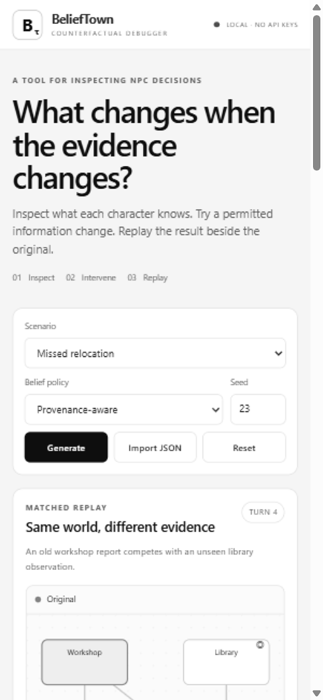

# BeliefTown

[](LICENSE)
[](pyproject.toml)

**A counterfactual debugger for information-dependent NPC decisions.**

Inspect what a character knows, request a different next search destination, and find the smallest permitted delivery of existing evidence that produces it. Replay the consequences without changing the parcel’s physical history or forcing the character’s action.

[](artifacts/browser/desktop.png)

<details>
<summary>View the mobile layout (390 × 844)</summary>

<a href="artifacts/browser/mobile.png"></a>
</details>

Click either preview to open its full-resolution image.

BeliefTown is a complete, local research implementation: a simulator, exact Bayesian belief engine, search-order planner, provenance-aware replay system, minimum-patch verifier, browser application, Jupyter notebooks, trained graph rankers, synthetic benchmark, and auditable results. The **core needs only Python and NumPy**. There is no LLM service, API key, or runtime network requirement.

## Start here

[Try the recorded demo](https://www.aitbourich.com/belieftown/demo/) · [Read the article](https://www.aitbourich.com/blog/belieftown-npcs-can-be-wrong)

The hosted demo uses precomputed verified results. Run locally for new interventions.

Clone the repository and create a local environment:

```bash
git clone https://github.com/VeinDevTtv/BeliefTown.git
cd BeliefTown
python -m venv .venv
# macOS / Linux:
source .venv/bin/activate
# Windows PowerShell instead:
# .venv\Scripts\Activate.ps1
python -m pip install -e .
python -m belieftown demo
```

The application prints its loopback address and opens a browser. This minimal installation includes the exact debugger and HTML export. For model training and notebooks, install `python -m pip install -e ".[all]"`. Installing dependencies initially requires a package source; the installed application does not require internet access.

To inspect the project without installing anything, open **`artifacts/BeliefTown_Showcase.html`** in a browser. This is explicitly a **recorded showcase**: playback, character inspection, and the featured patch replay are interactive, but its verified search results were precomputed. Arbitrary new interventions run in the Python application.

A captioned **[60-second walkthrough](artifacts/walkthrough/BeliefTown_Walkthrough.mp4)** is also included, assembled from actual UI states in the refreshed monochrome interface. Its frame manifest records exactly what is shown; it is not a continuous real-time performance measurement.

Start with **[the guided first run](docs/START_HERE.md)**, then see **[the mathematical specification](docs/MATH.md)** and **[the implementation map](docs/ARCHITECTURE.md)**. The [model card](docs/MODEL_CARD.md) and [data card](docs/DATA_CARD.md) explain the learned rankers and their benchmark.

## The 60-second demonstration

The Courier believes the parcel is in the Workshop; the parcel is actually in the Library. Mira has a newer observation that the Courier has not received. At turn 4, request **Courier → Library**, then click **Find minimum information patch**. The result is one permitted delivery: Mira’s `new-library` observation. Apply it and play the matched replays.

Reset. Manually forward `old-workshop` from Mira to the Courier. The delivery is logged, but the belief does not change: that root was already known. Copies are not independent corroboration.

Reset again. Protect the Courier from new deliveries and repeat the target-action query. The debugger reports **no solution within the configured bounds**, not an invented explanation.

## What is actually learned?

The NPC uses exact finite-state filtering and expected-cost planning. An optional two-layer relational graph network learns to **rank candidate information patches** from labels generated by exact execution. A non-graph MLP and a provenance-removal ablation provide comparisons. The learned score only changes search order; the simulator and verifier decide feasibility and minimum size.

The release trained **three seeds for each of three model variants**, using whole-scene splits and held-out larger-world cases. **The graph model did not establish a runtime advantage over the heuristic on this small benchmark.** The default search order is therefore the likelihood heuristic. The [benchmark report](artifacts/evaluation/RESULTS.md) includes measurements, uncertainty intervals, per-scene results, and checkpoint hashes.

This is an engineering and research artifact, **not a claim that Bayesian NPCs, graph networks, or counterfactual explanations are new inventions**.

## Command-line workflow

```bash
# Produce a portable audit bundle.
python -m belieftown solve --room Library --output artifacts/my-audit.json

# Re-execute the patch and exhaust all smaller candidates independently of the ranker.
python -m belieftown verify artifacts/my-audit.json

# Apply the verified intervention and export its complete replay.
python -m belieftown replay artifacts/my-audit.json --output artifacts/my-replay.json

# Generate a custom deterministic scene.
python -m belieftown generate --seed 42 --rooms 5 --output scenarios/my-scene.json

# Train one model, or rebuild the complete small pipeline.
python -m belieftown train --kind graph --seed 0 --epochs 14 --output artifacts/checkpoints/custom.pt
# Rebuild and evaluate the compact experiment.
python -m belieftown reproduce --profile quick

# Rebuild the released-sized experiment, in a separate output directory.
python -m belieftown reproduce --profile release --output artifacts/rebuilt-release --notebooks

# Execute all four notebooks with errors disallowed.
python -m belieftown notebooks

# Inspect installed components.
python -m belieftown doctor
```

`python -m belieftown --help` documents all commands. The installed `belieftown` entry point is equivalent.

## Jupyter

```bash
jupyter lab notebooks
```

Open the notebooks in order: beliefs, debugger, training, evaluation. The debugger notebook embeds the **same Python-backed browser application**, rather than a separate notebook-only simulator. Keep its kernel alive; rerun the launch cell to create a new local session. The server can also be opened in a separate browser tab.

This interface targets **local Jupyter**. Hosted notebook services may not expose a loopback port to your browser; use the saved static outputs or run the local application. The project does not silently tunnel a server to the internet. See [notebook usage](docs/NOTEBOOKS.md).

## Scope and assumptions

The demonstration has four rooms, three NPCs, one parcel, structured evidence, and a turn-based search phase. The code supports bounded 2–7-room scenes. The parcel is stationary during search. Private observations are declared sensor records; actual room inspections are generated by the simulator. This is not a vision system, free-form conversational agent, or commercial-engine plugin.

A **minimum** means the fewest deliveries within the recorded finite candidate universe and cardinality bound. Source reliability is configured per observation, not learned as human trust. Distinct roots are assumed conditionally independent; copied roots retain their origins. Message schedules are exogenous, and silence is not evidence. A target NPC must be active and must not already have found the parcel.

The exact verifier certifies a result only within its recorded candidate universe and search bound. The local server is designed for a single local user, not public internet hosting.

## Repository contents

| Location | Purpose |
|---|---|
| `src/belieftown/` | Reusable Python package, CLI, and local application |
| `src/belieftown/static/` | Self-contained browser interface; no CDN assets |
| `notebooks/` | Four executable research notebooks |
| `scenarios/` | Six authored demonstration families |
| `benchmarks/data/` | Procedural scene splits, exact labels, and hash manifest |
| `artifacts/checkpoints/` | Nine trained CPU checkpoints and training histories |
| `artifacts/evaluation/` | Raw measurements, uncertainty intervals, and report |
| `artifacts/executed_notebooks/` | Executed copies with saved outputs |
| `artifacts/BeliefTown_Showcase.html` | Generated no-install recorded demonstration |
| `docs/` | Mathematics, architecture, model/data cards, and references |

## License and contribution

Original code, documentation, generated scenarios, checkpoints, and original interface assets are released under **MIT**. Dependencies retain their own licenses; they are not vendored. See [LICENSE](LICENSE), [THIRD_PARTY_NOTICES.md](THIRD_PARTY_NOTICES.md), and [CONTRIBUTING.md](CONTRIBUTING.md). Citation metadata is provided in `CITATION.cff`.

Maintained by [VeinDevTtv](https://github.com/VeinDevTtv). Report reproducible bugs through [GitHub Issues](https://github.com/VeinDevTtv/BeliefTown/issues), or read the contribution guide before opening a pull request. Downloadable releases are available on the [releases page](https://github.com/VeinDevTtv/BeliefTown/releases). The project is not currently published on PyPI.
